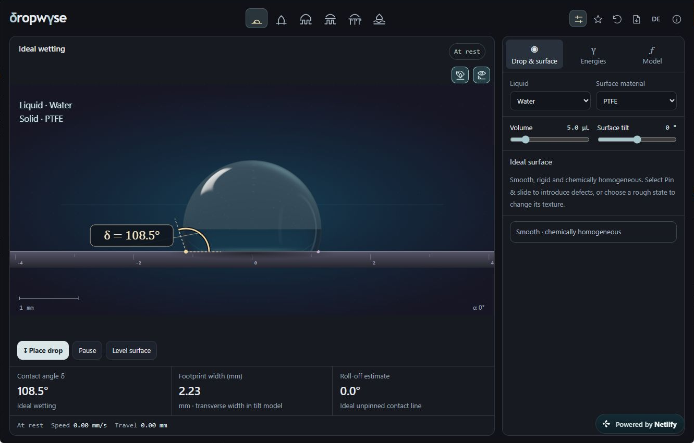

# Dropwyse — δropwγse

Dropwyse is an interactive teaching app for wetting, contact angles and surface roughness. Explore ideal wetting, pinning and sliding, Wenzel and Cassie–Baxter states, re-entrant textures, and liquid-infused surfaces. The interface supports English and German and runs entirely in the browser.

| Branch | Cloudflare address |
| --- | --- |
| `main` — student version | https://dropwyse.ipt-apps.workers.dev/ |
| `dev` — development | https://dev-dropwyse.ipt-apps.workers.dev/ |

These are the deployment addresses configured for the migration. They become available after the repository is connected to Cloudflare Workers Builds.



## Build and check

Use Node.js 22 or later. The app and checks have no package dependencies.

```sh
npm test
npm run build
```

The deployable site is written to `build/deploy/`. Serve that folder with a static HTTP server for local preview, or open its `index.html` directly. WebGL provides the optical droplet rendering, with an SVG fallback.

`npm run build -- --baseline` writes an exact copy of `src/index.html` to `build/baseline/`. This preserves the original migrated bytes. The deployment build adds only the package version to the existing credit line in the information card; the credit remains translatable. The source HTML is marked as non-normalized in Git to preserve its original line endings.

## Teaching model

The app implements the ideal, Wenzel and Cassie–Baxter relations and an illustrative pinning/sliding model. The microscopic view uses a two-dimensional capillary-entry approximation to explain suspended-state survival and collapse; it does not reproduce full three-dimensional experimental failure pressures. Material presets and their limits are explained in the app's Model and Sources panels. Literature-informed lubricant hysteresis is distinguished from measured values for particular experimental systems.

Use `#de` or `?lang=de` to link directly to German, and `#en` or `?lang=en` for English. A valid language fragment takes precedence over the query parameter. Selecting another language updates the fragment.

## Deployment

Connect this repository to Cloudflare **Workers**, with `main` as the production branch. Build command: `npm run build`; deploy command: `npx wrangler deploy`; preview command: `npx wrangler preview`. The Worker asset directory and preview configuration are in `wrangler.jsonc`.

Develop on `dev`; merge into `main` only when the changes are ready for students. Update the package version for a release and tag that release, for example `v1.0`.

Dropwyse is distributed under the MIT License. It uses system fonts and has no embedded font files or third-party image assets. The app screenshot is included under the same license.
